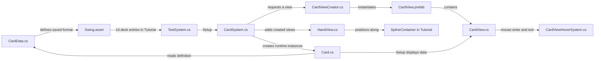
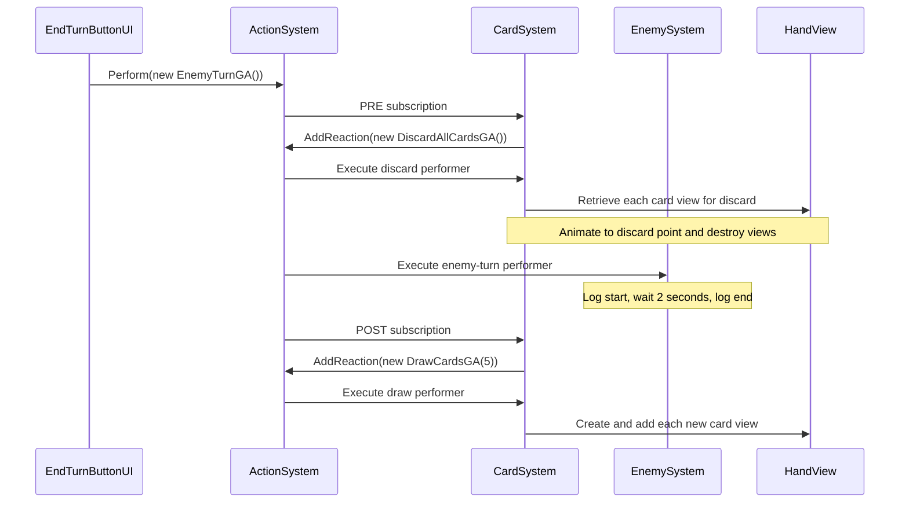

# Steam Chase — Project Files and Relationships

> **Historical snapshot:** This page describes an earlier prototype. For the current card architecture and instructions for adding stun bars, card effects, and status effects, use the [Developer Implementation Guide](DEVELOPER_IMPLEMENTATION_GUIDE.md).

**Snapshot: 27 September 2026 · Unity 6000.3.24f1**

Steam Chase currently contains a prototype card-hand system: create cards from saved data, draw them into a curved hand, show a larger preview on hover, discard the hand, and run a placeholder enemy turn.

Start with this guide to understand the project. Use the [complete file inventory](PROJECT_FILE_INVENTORY.md) to find any individual file, including metadata, downloaded packages, generated caches, and Git internals.

This guide describes the files saved on disk, including existing uncommitted work. It is based on reading the gameplay code, configuration, and serialized scene/asset references. Runtime behavior was traced from code; Unity Play Mode and the test runner were not executed. Binary files are described by their role and references, without decompiling them.

## Contents

1. [Where to start](#1-where-to-start)
2. [Folder map](#2-folder-map)
3. [How the game files connect](#3-how-the-game-files-connect)
4. [Every gameplay script](#4-every-gameplay-script)
5. [Scenes, prefab, and card data](#5-scenes-prefab-and-card-data)
6. [Images and empty content folders](#6-images-and-empty-content-folders)
7. [Rendering and input assets](#7-rendering-and-input-assets)
8. [Third-party files](#8-third-party-files)
9. [Packages and project settings](#9-packages-and-project-settings)
10. [Tests, root files, and local settings](#10-tests-root-files-and-local-settings)
11. [Metadata and generated files](#11-metadata-and-generated-files)
12. [Current gaps that affect these relationships](#12-current-gaps-that-affect-these-relationships)
13. [Which files to change for a task](#13-which-files-to-change-for-a-task)

## 1. Where to start

Read these in order:

| Step | File | What it helps you understand |
| --- | --- | --- |
| 1 | [Tutorial.unity](Assets/Scenes/Tutorial.unity) | How the current systems, views, deck, and button are assembled. Open this scene in Unity to inspect its hierarchy. |
| 2 | [CardData.cs](Assets/Script/Data/CardData.cs) and [Card.cs](Assets/Script/Models/Card.cs) | The difference between saved card definitions and cards created while the game runs. |
| 3 | [TestSystem.cs](Assets/Script/System/TestSystem.cs) | The startup entry point that supplies the deck to `CardSystem`. |
| 4 | [CardSystem.cs](Assets/Script/System/CardSystem.cs) | Drawing, discarding, and recycling cards. |
| 5 | [ActionSystem.cs](Assets/Script/System/ActionSystem.cs) and [GameAction.cs](Assets/Script/Combat/GameAction.cs) | How actions execute and trigger other actions. |
| 6 | [CardViewCreator.cs](Assets/Script/Creator/CardViewCreator.cs), [CardView.cs](Assets/Script/Combat/CardView.cs), and [HandView.cs](Assets/Script/Combat/HandView.cs) | How runtime cards become visible objects and move into the hand. |

**Current scene distinction:** `Tutorial.unity` contains the current gameplay setup. `ProjectSettings/EditorBuildSettings.asset` lists only `SampleScene.unity` as enabled. The latter contains a `CardView` script reference that does not resolve to a current script asset.

### Small glossary

| Term | Meaning in this project |
| --- | --- |
| Model | A C# object holding game data, such as `Card`. |
| View | An object displaying game data, such as `CardView` or `HandView`. |
| System | A component coordinating behavior, such as drawing cards or executing actions. |
| ScriptableObject | A saved Unity data asset; `CardData` defines the format of `Swing.asset`. |
| Prefab | A reusable Unity object template; `CardView.prefab` is instantiated for drawn cards. |
| GA | The naming suffix for a **Game Action**, such as `DrawCardsGA`. |
| Performer | The coroutine registered to execute one action type. |
| Reaction | Another action added before, during, or after the current action. |
| GUID | An asset identifier stored in a `.meta` file and used by Unity references. |

## 2. Folder map

```text
Steam Chase/
|-- Assets/
|   |-- Animations/                 Empty placeholder
|   |-- CardInfos/                  Saved card definitions and deck folders
|   |-- images/                     Background, card frame, and status icons
|   |-- Plugins/Demigiant/DOTween/  Animation library and its editor tools
|   |-- Prefabs/                    Reusable CardView object
|   |-- Resources/                  DOTween configuration
|   |-- Scenes/                     Tutorial and SampleScene
|   |-- Script/
|   |   |-- Combat/                 Card views and action definitions
|   |   |   `-- GameAction/         Draw, discard, and enemy-turn action types
|   |   |-- Creator/                Card-view factory
|   |   |-- Data/                   Saved card-data definition
|   |   |-- Extensions/             Random list-draw helper
|   |   |-- General/                Singleton base class
|   |   |-- Models/                 Runtime card model
|   |   |-- System/                 Startup, cards, actions, enemy, hover
|   |   `-- UI/                     End-turn button handler
|   |-- Settings/                   Render pipeline, input, and scene template
|   `-- TextMesh Pro/               Fonts, materials, shaders, and text resources
|-- Packages/                       Requested and resolved Unity dependencies
|-- ProjectSettings/                Shared Unity project configuration
|-- Tests/                          Checks for an older combat implementation
|-- UserSettings/                   Local editor preferences
|-- Library/, Temp/, obj/, Logs/    Generated Unity/compiler data
|-- .vs/                            Local Visual Studio data
|-- .git/                           Git history and repository bookkeeping
|-- *.csproj, *.sln                 Generated IDE project files
|-- PROJECT_FILE_GUIDE.md           This guide
`-- PROJECT_FILE_INVENTORY.md       Complete file list from the scan
```

At the scan, `Assets/` held **102 content files and 145 metadata files**. The content includes **18 gameplay C# scripts**, **9 DOTween module scripts**, two main scenes, a scene-template scene, one prefab, and one card-data asset. `ProjectSettings/` contains 26 files.

## 3. How the game files connect

### Data becomes a visible card



In plain language: **saved card definition → runtime card → instantiated card view → hand layout**. The scene supplies the object references that join these scripts together.

### Startup

1. Unity loads the objects saved in `Tutorial.unity`. Singleton components set their `Instance` in `Awake()`.
2. `CardSystem.OnEnable()` registers draw/discard performers and reactions to enemy turns. `EnemySystem.OnEnable()` registers the enemy-turn performer.
3. `TestSystem.Start()` passes its `deckData` list to `CardSystem.Setup()`.
4. `Setup()` creates a separate `Card` object for each entry and adds it to the draw pile. The saved scene contains **10 entries referencing the same `Swing.asset`**.
5. **Startup does not draw a hand.** There is no initial `DrawCardsGA` call in the current startup code.

### End-turn flow



The dispatcher processes **PRE reactions → performer and its reactions → POST reactions**. A new top-level `Perform()` request is ignored while another top-level action is running.

For each draw, `ListExtension.Draw()` randomly removes a card from the draw pile. `CardViewCreator` instantiates and scales in its view, and `HandView` moves and rotates the views along a spline. When the draw pile cannot supply the requested amount, `CardSystem` transfers the discard pile back into it and attempts the remaining draws.

The enemy currently logs messages and waits; it does not attack or modify health. See [current gaps](#12-current-gaps-that-affect-these-relationships) for limitations of the discard and draw code.

### Hover flow

`CardView.OnMouseEnter()` hides that card's `Wrapper` and asks `CardViewHoverSystem` to show the same `Card` in a separate preview view. The preview uses the hovered card's X position and a fixed Y of `-2`. On exit, it hides the preview and restores the original wrapper.

## 4. Every gameplay script

Paths in the following tables start at `Assets/Script/`. Every gameplay `.cs` file present at the scan is listed here.

### Card data and display

| File | Responsibility | Main relationships |
| --- | --- | --- |
| [Data/CardData.cs](Assets/Script/Data/CardData.cs) | Defines a `ScriptableObject` with description, sprite, and cost. Adds a `CardData` asset-creation menu entry. | Defines `Swing.asset`; read by `Card`; referenced by `TestSystem.deckData`. The asset name supplies the card title. |
| [Models/Card.cs](Assets/Script/Models/Card.cs) | Runtime card object. Exposes title, description, and image from its definition; copies the initial cost into its own property. | Constructed by `CardSystem`; holds a `CardData`; displayed by `CardView`. |
| [Combat/CardView.cs](Assets/Script/Combat/CardView.cs) | Writes the card's title, description, cost, and image into scene components. Handles mouse hover. | Attached to `CardView.prefab`; uses three `TextMeshPro` fields, a `SpriteRenderer`, `Wrapper`, and `CardViewHoverSystem`. |
| [Combat/HandView.cs](Assets/Script/Combat/HandView.cs) | Keeps a list of card views and animates their positions/rotations along a spline. Finds a view for a particular `Card`. | Called by `CardSystem`; uses `CardView`, Unity Splines, LINQ, and DOTween. `RemoveCard()` currently returns the view without removing it from its internal list. |
| [Creator/CardViewCreator.cs](Assets/Script/Creator/CardViewCreator.cs) | Instantiates the assigned card prefab, scales it from zero to one over 0.15 seconds, then calls `Setup(card)`. | Inherits `SingleTon<CardViewCreator>`; called by `CardSystem`; depends on `CardView.prefab`, `CardView`, and DOTween. |
| [System/CardViewHoverSystem.cs](Assets/Script/System/CardViewHoverSystem.cs) | Shows or hides a separate preview card and assigns its position/data. | Inherits `SingleTon<CardViewHoverSystem>`; called by `CardView`; references an initially inactive prefab instance in `Tutorial.unity`. |

### Actions and turn behavior

| File | Responsibility | Main relationships |
| --- | --- | --- |
| [Combat/GameAction.cs](Assets/Script/Combat/GameAction.cs) | Abstract action base with `PreReactions`, `PerformReactions`, and `PostReactions` lists. | Base class for all three action types; processed recursively by `ActionSystem`. |
| [Combat/ReactionTiming.cs](Assets/Script/Combat/ReactionTiming.cs) | Defines the `PRE` and `POST` subscription timings. | Used by `ActionSystem` and `CardSystem` when registering reactions. |
| [Combat/GameAction/DrawCardsGA.cs](Assets/Script/Combat/GameAction/DrawCardsGA.cs) | Draw request carrying an integer `Amount`. | Created by `CardSystem` after an enemy turn; dispatched to its draw performer by `ActionSystem`. |
| [Combat/GameAction/DiscardAllCardsGA.cs](Assets/Script/Combat/GameAction/DiscardAllCardsGA.cs) | Action type requesting a full-hand discard; no extra fields. | Created by `CardSystem` before an enemy turn; handled by its discard performer. |
| [Combat/GameAction/EnemyTurnGA.cs](Assets/Script/Combat/GameAction/EnemyTurnGA.cs) | Action type representing an enemy turn; no extra fields. | Created by `EndTurnButtonUI`; performed by `EnemySystem`; surrounded by `CardSystem` reactions. |
| [System/ActionSystem.cs](Assets/Script/System/ActionSystem.cs) | Registers performers/subscribers by action type and runs actions as coroutines. Exposes a busy flag. | Inherits `SingleTon<ActionSystem>`; used by the button, `CardSystem`, and `EnemySystem`; executes `GameAction` reaction lists. |
| [System/CardSystem.cs](Assets/Script/System/CardSystem.cs) | Owns the draw pile, hand, and discard pile. Registers card performers and enemy-turn reactions. | Inherits `SingleTon<CardSystem>`; receives data from `TestSystem`; uses `Card`, `ListExtension`, `CardViewCreator`, `HandView`, DOTween, and scene pile markers. |
| [System/EnemySystem.cs](Assets/Script/System/EnemySystem.cs) | Registers an `EnemyTurnGA` performer that logs, waits two seconds, and logs again. | Registers/detaches through `ActionSystem` in `OnEnable()`/`OnDisable()`. No enemy data or damage logic yet. |
| [UI/EndTurnButtonUI.cs](Assets/Script/UI/EndTurnButtonUI.cs) | Public `Onclick()` method creates an `EnemyTurnGA` and submits it. | Wired to the `EndTurn` button's click event in `Tutorial.unity`; calls `ActionSystem.Instance.Perform()`. |

### Setup and helpers

| File | Responsibility | Main relationships |
| --- | --- | --- |
| [System/TestSystem.cs](Assets/Script/System/TestSystem.cs) | Scene bootstrap component that holds the test deck and calls setup in `Start()`. | References a `List<CardData>`; invokes `CardSystem.Instance.Setup(deckData)`. Despite its name, it is gameplay setup, not an automated test. |
| [Extensions/ListExtension.cs](Assets/Script/Extensions/ListExtension.cs) | Adds `Draw<T>()` to lists: choose a random item, remove it, and return it. Returns `default` for an empty list. | Used by `CardSystem.DrawCard()`; uses `UnityEngine.Random`. |
| [General/SingleTon.cs](Assets/Script/General/SingleTon.cs) | Generic component base exposing a static `Instance`, destroying duplicates, and clearing the instance on application quit. Also contains a nested persistent variant. | Base for `ActionSystem`, `CardSystem`, `CardViewCreator`, and `CardViewHoverSystem`. No current gameplay class derives from the nested `PersistentSingleTon` variant. |

## 5. Scenes, prefab, and card data

| File | Role | Connected files |
| --- | --- | --- |
| [Assets/Scenes/Tutorial.unity](Assets/Scenes/Tutorial.unity) | Current assembled card-system prototype. Contains camera/background, systems, hand spline, pile markers, Canvas, EventSystem, end-turn button, and hover preview. | Connects the current gameplay components, `Swing.asset`, `CardView.prefab`, background art, TMP font, and package components. |
| [Assets/Scenes/SampleScene.unity](Assets/Scenes/SampleScene.unity) | A separate card/UI scene and the only enabled scene in the saved build list. Its `Card` object has old serialized field names and an unresolved script GUID. | References card-frame art, TMP font, UI/input components, and the unresolved old `CardView` script. It does not contain the current `ActionSystem`/`CardSystem` setup. |
| [Assets/Prefabs/CardView.prefab](Assets/Prefabs/CardView.prefab) | Reusable world-space card, with a `CardView`, `BoxCollider2D`, `SortingGroup`, sprites, and TMP text children. | Created by `CardViewCreator`; also used as the scene's hover preview. Uses `CardBase.png`, a placeholder `FollowUpAttack.png` sprite, and the Liberation Sans SDF font. |
| [Assets/CardInfos/Whiskey/Swing.asset](Assets/CardInfos/Whiskey/Swing.asset) | The only saved card definition. Name: `Swing`; description: `Deal 6 damage`; cost: `1`; image: `ExtraAttack.png`. | Uses `CardData.cs`; referenced ten times by the tutorial deck. The description is display text; it does not implement six damage. |

### Tutorial scene wiring

These assignments are saved in `Tutorial.unity`; they are not automatically discovered by the scripts.

| Scene object/component | Serialized field or event | Assigned target |
| --- | --- | --- |
| `TestSystem` | `deckData` | Ten references to `Swing.asset`. |
| `CardSystem` | `handView` | The scene's `HandView` component. |
| `CardSystem` | `drawPilePoint` | `DrawPilePoint` transform. |
| `CardSystem` | `discardPilePoint` | `DiscardPilePoint` transform. |
| `CardViewCreator` | `cardViewPrefab` | `Assets/Prefabs/CardView.prefab`. |
| `HandView` | `splineContainer` | `Spline` object's `SplineContainer`. |
| `CardViewHover` | `cardViewHover` | A `CardView.prefab` instance, initially inactive, scaled to 1.25; its collider is disabled. |
| `EndTurn` button | `Button.onClick` | `EndTurnButtonUI.Onclick()`. |

### Card prefab wiring

| `CardView` field | Prefab child/component |
| --- | --- |
| `Title` | `Name` / `TextMeshPro`. |
| `Description` | `Effect` / `TextMeshPro`. |
| `Cost` | `Cost` / `TextMeshPro`. |
| `CardImage` | `CardImage` / `SpriteRenderer`. |
| `Wrapper` | The `Wrapper` GameObject containing the visual children. |

## 6. Images and empty content folders

All image paths below start at `Assets/images/`. “No reference found” means no incoming GUID reference was found in the scanned project text assets; it does not prove an image can never be used dynamically.

| File | Purpose / observed relationship |
| --- | --- |
| `BG/SteamPunk BG.png` | Background sprite referenced by `Tutorial.unity`. |
| `Cards/CardBase.png` | Card frame referenced by `CardView.prefab` and `SampleScene.unity`. |
| `Icon/ExtraAttack.png` | Sprite selected by `Swing.asset`; displayed when a Swing card view is set up. |
| `Icon/FollowUpAttack.png` | Placeholder card image saved in `CardView.prefab`; runtime `Setup()` replaces it with the card's image. |
| `Icon/Aggravated.png` | Named effect/status icon; no incoming project-asset GUID reference found. |
| `Icon/ATKDown.png` | Named attack-down icon; no incoming project-asset GUID reference found. |
| `Icon/ATKUp.png` | Named attack-up icon; no incoming project-asset GUID reference found. |
| `Icon/DEFUp.png` | Named defense-up icon; no incoming project-asset GUID reference found. |
| `Icon/Mark.png` | Named mark icon; no incoming project-asset GUID reference found. |
| `Icon/Poison.png` | Named poison icon; no incoming project-asset GUID reference found. |
| `Icon/Shock.png` | Named shock icon; no incoming project-asset GUID reference found. |
| `Icon/Stress.png` | Named stress icon; no incoming project-asset GUID reference found. |
| `Icon/STUN.png` | Named stun icon; no incoming project-asset GUID reference found. |
| `Icon/Vulnerable.png` | Named vulnerable icon; no incoming project-asset GUID reference found. |

The names of the icons suggest intended effects. No corresponding status-effect implementation exists in the 18 current gameplay scripts.

These folders are empty placeholders: `Assets/Animations/`, `Assets/CardInfos/Ade/Deck1/`, `Deck2/`, `Deck3/`, and `Assets/CardInfos/Whiskey/Deck1/`, `Deck2/`, `Deck3/`. Each has a folder `.meta` file. `Swing.asset` sits directly in `Whiskey/`, outside its numbered deck folders.

## 7. Rendering and input assets

Paths start at `Assets/Settings/`, except the DOTween settings row.

| File | Responsibility and relationships |
| --- | --- |
| [UniversalRP.asset](Assets/Settings/UniversalRP.asset) | Universal Render Pipeline configuration. All six saved quality levels reference it; its renderer list selects `Renderer2D.asset`. |
| [Renderer2D.asset](Assets/Settings/Renderer2D.asset) | 2D renderer configuration, including light blend styles, shadows, and package shaders/materials. Used by `UniversalRP.asset`. |
| [UniversalRenderPipelineGlobalSettings.asset](Assets/Settings/UniversalRenderPipelineGlobalSettings.asset) | URP global resources/settings registered in `GraphicsSettings.asset`; references `DefaultVolumeProfile.asset`. |
| [DefaultVolumeProfile.asset](Assets/Settings/DefaultVolumeProfile.asset) | Default volume settings for effects such as color adjustments, bloom, tonemapping, and vignette. Referenced by URP global settings; its existence does not establish that every effect is enabled on a camera. |
| [InputSystem_Actions.inputactions](Assets/Settings/InputSystem_Actions.inputactions) | Project input-action asset registered in `EditorBuildSettings.asset`. Contains `Player` and `UI` maps and keyboard/mouse, gamepad, touch, joystick, and XR control schemes. |
| [Lit2DSceneTemplate.scenetemplate](Assets/Settings/Lit2DSceneTemplate.scenetemplate) | “Lit 2D” scene-creation template pointing to `Scenes/URP2DSceneTemplate.unity`. Also contains an unresolved dependency GUID; see the inventory. |
| [Scenes/URP2DSceneTemplate.unity](Assets/Settings/Scenes/URP2DSceneTemplate.unity) | Template scene with a camera and a global 2D light. Used to create scenes; absent from the enabled build list. |
| [Assets/Resources/DOTweenSettings.asset](Assets/Resources/DOTweenSettings.asset) | DOTween defaults and module switches; serialized type comes from `DOTween.dll`. Supports the animation calls in the creator, hand, and card systems. |

The `Player` input map defines Move, Look, Attack, Interact, Crouch, Jump, Previous, Next, and Sprint. The `UI` map defines navigation, submit/cancel, pointer clicks, scroll, and tracked-device actions. Their presence is configuration, not evidence that these gameplay abilities are implemented. The current card scripts use mouse callbacks and the scene's button click event.

Rendering relationship:

```text
ProjectSettings/QualitySettings.asset
  -> Assets/Settings/UniversalRP.asset
     -> Assets/Settings/Renderer2D.asset

ProjectSettings/GraphicsSettings.asset
  -> Assets/Settings/UniversalRenderPipelineGlobalSettings.asset
     -> Assets/Settings/DefaultVolumeProfile.asset
```

`GraphicsSettings.asset` has no default pipeline assigned in its `m_CustomRenderPipeline` field; the saved quality levels supply `UniversalRP.asset`.

## 8. Third-party files

### DOTween

All paths in this table start at `Assets/Plugins/Demigiant/DOTween/`. These are vendor files. The current game's direct animation calls are in `CardViewCreator`, `HandView`, and `CardSystem`.

| File | Role and relationship |
| --- | --- |
| `DOTween.dll` | Compiled runtime animation library providing `DG.Tweening`, tweens, and transform-animation APIs. |
| `DOTween.dll.mdb` | Debug symbols accompanying the runtime DLL; supports debugging rather than gameplay logic. |
| `DOTween.XML` | API documentation accompanying the runtime DLL; used by IDE tooling. |
| `readme.txt` | Vendor setup, upgrade, documentation, and license pointers. |
| `Editor/DOTweenEditor.dll` | Unity Editor integration and setup/preferences tooling. |
| `Editor/DOTweenEditor.dll.mdb` | Debug symbols accompanying the editor DLL. |
| `Editor/DOTweenEditor.XML` | API documentation accompanying the editor DLL. |
| `Editor/Imgs/DOTweenIcon.png` | Image resource for DOTween's editor UI. |
| `Editor/Imgs/DOTweenMiniIcon.png` | Smaller image resource for DOTween's editor UI. |
| `Editor/Imgs/Footer.png` | Editor UI footer image. |
| `Editor/Imgs/Footer_dark.png` | Dark-theme editor UI footer image. |
| `Editor/Imgs/Header.jpg` | Editor UI header image. |
| `Modules/DOTweenModuleAudio.cs` | Tween extensions for audio sources and mixers. No direct custom-gameplay use found. |
| `Modules/DOTweenModulePhysics.cs` | Tween extensions for 3D rigidbodies. No direct custom-gameplay use found. |
| `Modules/DOTweenModulePhysics2D.cs` | Tween extensions for 2D rigidbodies. Current card movements target transforms instead. |
| `Modules/DOTweenModuleSprite.cs` | Sprite-renderer color/fade extensions. No direct custom-gameplay use found. |
| `Modules/DOTweenModuleUI.cs` | uGUI tween extensions for UI components. No direct custom-gameplay use found. |
| `Modules/DOTweenModuleUIToolkit.cs` | Optional UI Toolkit integration; disabled in the saved DOTween settings. |
| `Modules/DOTweenModuleUnityVersion.cs` | Unity-version-related helpers, material extensions, and coroutine/async waiting utilities. |
| `Modules/DOTweenModuleUtils.cs` | Module initialization and shared physics/path integration helpers. |
| `Modules/DOTweenModuleEPOOutline.cs` | Optional EPO Outline integration guarded by compilation symbols; disabled in saved settings. |

### TextMesh Pro resources

Paths start at `Assets/TextMesh Pro/`. The current card prefab uses world-space `TextMeshPro`; Canvas text in the scenes uses `TextMeshProUGUI`. Both rely on the installed TMP/uGUI implementation and these imported resources.

| File | Role and relationship |
| --- | --- |
| `Fonts/LiberationSans.ttf` | Source font; referenced by the fallback font asset. |
| `Fonts/LiberationSans - OFL.txt` | Font license accompanying Liberation Sans. |
| `Resources/TMP Settings.asset` | Default TMP configuration; references the main font, line-breaking files, emoji sprite asset, and default style sheet. |
| `Resources/Fonts & Materials/LiberationSans SDF.asset` | Main font atlas/material data used by both main scenes and `CardView.prefab`; references the fallback and `TMP_SDF.shader`. |
| `Resources/Fonts & Materials/LiberationSans SDF - Fallback.asset` | Fallback font data; references the TTF source and `TMP_SDF-Mobile.shader`. |
| `Resources/Fonts & Materials/LiberationSans SDF - Drop Shadow.mat` | Optional shadow material using the main font atlas and mobile SDF shader. |
| `Resources/Fonts & Materials/LiberationSans SDF - Outline.mat` | Optional outline material using the main font atlas and mobile SDF shader. |
| `Resources/LineBreaking Following Characters.txt` | Text wrapping character rules consumed through TMP settings. |
| `Resources/LineBreaking Leading Characters.txt` | Complementary text wrapping character rules consumed through TMP settings. |
| `Resources/Style Sheets/Default Style Sheet.asset` | Default TMP text-style definitions. |
| `Resources/Sprite Assets/EmojiOne.asset` | Inline-sprite definitions referencing `EmojiOne.png` and `TMP_Sprite.shader`. |
| `Sprites/EmojiOne.png` | Emoji texture atlas used by the sprite asset. |
| `Sprites/EmojiOne.json` | Source sprite-name/rectangle mapping accompanying the emoji atlas. |
| `Sprites/EmojiOne Attribution.txt` | Attribution/license information accompanying the emoji resources. |

### TextMesh Pro shaders

Paths start at `Assets/TextMesh Pro/Shaders/`. These are imported text-rendering variants, not individual gameplay systems. SDF means **signed distance field**, a font-atlas technique for rendering scalable text.

| File | Role |
| --- | --- |
| `TMP_SDF.shader` | Main SDF shader; referenced by the project's primary font asset. |
| `TMP_SDF Overlay.shader` | SDF overlay variant. |
| `TMP_SDF SSD.shader` | SDF variant using screen-space derivatives. |
| `TMP_SDF-Mobile.shader` | Mobile SDF variant used by fallback and optional font materials. |
| `TMP_SDF-Mobile Overlay.shader` | Mobile overlay variant. |
| `TMP_SDF-Mobile SSD.shader` | Mobile screen-space-derivative variant. |
| `TMP_SDF-Mobile Masking.shader` | Mobile masked-text variant. |
| `TMP_SDF-Mobile-2-Pass.shader` | Two-pass mobile text-rendering variant. |
| `TMP_SDF-Surface.shader` | Surface-shader text variant. |
| `TMP_SDF-Surface-Mobile.shader` | Mobile surface-shader text variant. |
| `TMP_SDF-URP Lit.shadergraph` | URP lit text Shader Graph. |
| `TMP_SDF-URP Unlit.shadergraph` | URP unlit text Shader Graph. |
| `TMP_SDF-HDRP LIT.shadergraph` | HDRP lit text Shader Graph; imported resource in this URP project. |
| `TMP_SDF-HDRP UNLIT.shadergraph` | HDRP unlit text Shader Graph; imported resource in this URP project. |
| `TMP_Bitmap.shader` | Bitmap-font rendering variant. |
| `TMP_Bitmap-Mobile.shader` | Mobile bitmap-font rendering variant. |
| `TMP_Bitmap-Custom-Atlas.shader` | Bitmap variant for a custom atlas. |
| `TMP_Sprite.shader` | Inline-sprite shader referenced by the emoji sprite asset. |
| `TMPro.cginc` | Shared shader code included by TMP shader variants. |
| `TMPro_Mobile.cginc` | Shared mobile shader code. |
| `TMPro_Properties.cginc` | Shared shader property declarations. |
| `TMPro_Surface.cginc` | Shared surface-shader implementation. |
| `SDFFunctions.hlsl` | Shared SDF functions used by Shader Graph resources. |

## 9. Packages and project settings

### Package files

| File | Role and relationship |
| --- | --- |
| [Packages/manifest.json](Packages/manifest.json) | Declares 53 direct Unity package/module dependencies and requested versions. |
| [Packages/packages-lock.json](Packages/packages-lock.json) | Records 67 resolved dependencies, their sources, depth, and dependency relationships. Includes 14 transitive packages/modules. |

Resolved package contents live under `Library/PackageCache/`. Package presence does not mean a feature is used by the game. The inventory includes every direct/transitive package and its recorded dependencies, plus the cached file paths.

| Dependency | Version in this snapshot | Relationship to the project |
| --- | --- | --- |
| `com.unity.render-pipelines.universal` | 17.3.0 | URP settings, 2D renderer, and camera/rendering components. |
| `com.unity.splines` | 2.9.1 | `HandView` evaluates the tutorial hand's `SplineContainer`. |
| `com.unity.ugui` | 2.0.0 | Canvas, Button, EventSystem UI, and installed TMP implementation. |
| `com.unity.inputsystem` | 1.20.0 | Input-action asset and scene UI input modules. |
| `com.unity.test-framework` | 1.6.0 | Unity testing support; existing standalone tests target missing older code. |
| `com.unity.2d.*` packages | Multiple | Sprite, animation, tilemap, PSD/Aseprite import, and Sprite Shape tooling. Installed tooling exceeds the current card prototype's usage. |
| `com.unity.timeline` | 1.8.13 | Timeline tooling; no project Timeline asset found. |
| `com.unity.visualscripting` | 1.9.12 | Visual Scripting tooling; no gameplay graph asset found. |
| `com.unity.multiplayer.center` | 1.0.1 | Editor multiplayer tooling; no current multiplayer game implementation found. |
| `com.unity.ide.rider`, `com.unity.ide.visualstudio` | 3.0.40 / 2.0.26 | IDE integration and project-file generation. |
| `com.unity.collab-proxy` | 2.13.6 | Unity version-control integration tooling. |
| `com.unity.modules.*` | 1.0.0 | Built-in Unity subsystems such as audio, physics, UI, and animation. |

### Every ProjectSettings file

All paths start at `ProjectSettings/`. Settings configure the engine/editor and are not gameplay scripts.

| File | Responsibility / relationship |
| --- | --- |
| `ProjectVersion.txt` | Selects Unity editor version `6000.3.24f1`; also read by the standalone verification script when locating Unity assemblies. |
| `ProjectSettings.asset` | Player/build configuration, including application identity, platform, and scripting settings. |
| `EditorBuildSettings.asset` | Enabled scene list and input-action registration. Currently enables only `SampleScene.unity`; registers `InputSystem_Actions.inputactions`. |
| `EditorSettings.asset` | Editor workflow and serialization preferences. |
| `GraphicsSettings.asset` | Global graphics configuration and registration of URP global settings. |
| `QualitySettings.asset` | Quality presets; all six saved levels reference `UniversalRP.asset`. |
| `URPProjectSettings.asset` | URP editor/material migration bookkeeping. |
| `ShaderGraphSettings.asset` | Shader Graph variant/interpolator settings. |
| `AudioManager.asset` | Global audio configuration for Unity audio components. |
| `DynamicsManager.asset` | 3D physics configuration. |
| `Physics2DSettings.asset` | 2D physics configuration; relevant to 2D colliders, including the card prefab's collider. |
| `InputManager.asset` | Legacy input-axis settings; separate from the Input System action asset. |
| `TimeManager.asset` | Time scale and timestep settings affecting timed gameplay/coroutines. |
| `TagManager.asset` | Tags, object layers, and sorting layers. No custom tags or sorting layers are currently defined. |
| `NavMeshAreas.asset` | Navigation-area configuration; no gameplay navigation code found. |
| `MemorySettings.asset` | Engine memory-allocator settings. |
| `PackageManagerSettings.asset` | Unity Package Manager configuration; works with the files under `Packages/`. |
| `PresetManager.asset` | Default preset configuration for asset/component creation and import. |
| `SceneTemplateSettings.json` | Rules for copying/referencing dependencies when creating scenes from templates. |
| `VersionControlSettings.asset` | Unity version-control integration mode; currently `Visible Meta Files`. |
| `UnityConnectSettings.asset` | Unity service configuration. Main connection and listed analytics/ads/purchasing features are disabled in the saved file. |
| `MultiplayerManager.asset` | Multiplayer-role settings; multiplayer roles are disabled. |
| `NetworkManager.asset` | Engine network settings; no asset-to-prefab entries in the saved file. |
| `ClusterInputManager.asset` | Cluster/distributed input settings. |
| `VFXManager.asset` | Visual-effect engine settings. |
| `XRSettings.asset` | XR/VR configuration values; not proof that the game implements XR. |

## 10. Tests, root files, and local settings

### Tests

| File | Purpose | Current relationship |
| --- | --- | --- |
| [Tests/CombatManagerChecks.cs](Tests/CombatManagerChecks.cs) | Standalone checks for turn order, card selection/targeting, damage/healing, deck recycling, win/loss, and invalid inputs. | Imports a `CombatManager` API whose source is absent. Its nested card/battle types are different from the current `Models/Card.cs`. |
| [Tests/VerifyCombatManager.ps1](Tests/VerifyCombatManager.ps1) | Locates Unity/.NET assemblies, compiles the old combat files and checks, and runs the checks. Writes generated output to `Temp/CombatManagerVerification/`. | Expects `Assets/Script/CombatSystem/CombatManager.cs`, `CombatUnit.cs`, `PlayerUnit.cs`, and `EnemyUnit.cs`; all are absent at this snapshot. |

These checks document expectations from another implementation. They do not currently verify the new `ActionSystem`/`CardSystem` flow and cannot compile the required old sources as saved.

### Files at the project root

| File | Purpose / relationship |
| --- | --- |
| `.gitignore` | Excludes Unity caches, local IDE state, generated IDE projects, and other rebuildable/local outputs from normal Git tracking. |
| `.gitattributes` | Defines text/YAML handling and Git LFS patterns for images, DLLs, fonts, and other binaries. Also marks plugin/lockfile content as generated for GitHub display. |
| `.vsconfig` | Requests Visual Studio's managed game-development workload. |
| `Steam Chase.sln` | Generated Visual Studio solution grouping the C# projects. |
| `Assembly-CSharp.csproj` | Generated IDE project containing the 18 current gameplay scripts and references to Unity, packages, DOTween, and the first-pass project. |
| `Assembly-CSharp-firstpass.csproj` | Generated IDE project containing the nine DOTween module scripts under `Assets/Plugins/`. |
| `Assembly-CSharp-Editor.csproj` | Generated editor project. Its compile list still references absent `Assets/Script/CardSystem/Editor/CardDatabaseEditor.cs`, so it is stale. |
| `PROJECT_FILE_GUIDE.md` | Human-readable explanation of the saved project and its relationships. Created after the inventory scan. |
| `PROJECT_FILE_INVENTORY.md` | Searchable full path list, reference index, and package dependency catalog. Created after the inventory scan. |

### Local user settings

| File | Purpose / relationship |
| --- | --- |
| `UserSettings/EditorUserSettings.asset` | Per-user Unity Editor preferences/state. |
| `UserSettings/Layouts/default-6000.dwlt` | Saved editor-window layout. |
| `UserSettings/Search.index` | Local Unity Search index configuration/state. |
| `UserSettings/Search.settings` | Local Unity Search preferences. |

The `.vs/` directory contains local Visual Studio indexes/caches. These and `UserSettings/` support the developer's environment; gameplay does not directly read them.

## 11. Metadata and generated files

### How `.meta` files connect assets

Every one of the 102 content files under `Assets/` has a companion `.meta` file. Another 43 `.meta` files identify folders, for **145 total**. No orphaned asset metadata was found in that scan.

For example:

```text
Assets/Script/Data/CardData.cs.meta
  supplies a GUID used by Swing.asset's m_Script reference

Assets/CardInfos/Whiskey/Swing.asset.meta
  supplies a GUID used by Tutorial.unity's deckData entries

Assets/Prefabs/CardView.prefab.meta
  supplies a GUID used by Tutorial.unity's creator and hover-preview references
```

Texture `.meta` files also store import/sprite settings. DLL metadata controls plugin import settings. Unity's `fileID` identifies a component or sub-asset within a referenced asset, while the GUID identifies the asset itself. Preserve the `.meta` file when moving or renaming an asset so its references keep the same identity.

The inventory names every `.meta` file. Its companion is the same path without the final `.meta`; for folder metadata, that companion is a directory.

### Generated and repository-managed areas

The scan found **49,601 files**, including **913 Git-internal files** and **48,358 files in `Library/`**. These counts exclude the two Markdown documents created afterward and can change when Unity or an IDE runs.

| Area | File count | Producer and relationship |
| --- | ---: | --- |
| `Library/PackageCache/` | 30,888 | Downloaded/resolved package contents corresponding to `Packages/`; includes vendor code, documentation, tests, and resources. |
| `Library/Artifacts/` | 14,643 | Unity-imported/converted asset artifacts derived from source assets and importer settings. |
| `Library/Bee/` | 1,596 | Unity build/compiler work products and dependency data. |
| `Library/BurstCache/` | 710 | Burst-generated compilation cache. |
| `Library/ShaderCache/` | 292 | Compiled shader cache derived from shaders, pipeline settings, and graphics targets. |
| `Library/ScriptAssemblies/` | 176 | Compiled project/package assemblies and debugging files. |
| Other `Library/` files and folders | 53 | Asset databases, build profiles, editor state, UI state, search, API updater, and package-manager records. |
| `Logs/` | 12 | Editor/importer/package/build diagnostic output. |
| `Temp/` | 6 | Temporary Unity session/build files present at the scan. |
| `obj/` | 4 | Intermediate compiler/IDE output. |
| `.vs/` | 20 | Visual Studio's local working state. |
| `.git/` | 913 | Repository objects, references, configuration, logs, hooks, and index bookkeeping. |

These files are indexed individually in the [inventory](PROJECT_FILE_INVENTORY.md). Their roles are summarized by generating subsystem: this documentation does not reconstruct opaque binary cache dependencies or treat downloaded package internals as custom gameplay.

## 12. Current gaps that affect these relationships

These are observations from the saved source and references, not results of a Play Mode test. They are included so the architecture diagrams are not mistaken for a claim that every flow is complete.

| Observation | Files involved | Practical effect |
| --- | --- | --- |
| The enabled build scene differs from the scene containing the current systems. | `EditorBuildSettings.asset`, `SampleScene.unity`, `Tutorial.unity` | A build using the saved scene list starts from SampleScene, not the tutorial setup described here. |
| SampleScene has an unresolved old script GUID and old card-view fields. | `SampleScene.unity` | Its `Card` component does not resolve to the current `Combat/CardView.cs` asset. |
| Setup fills only the draw pile. | `TestSystem.cs`, `CardSystem.cs` | The initial hand is empty; the first normal five-card draw follows an enemy turn. |
| Hand removal does not remove the entry from `HandView.cards`. | `HandView.cs`, `CardSystem.cs` | Discard destroys a view that remains in the layout list; subsequent layout updates can encounter destroyed views. |
| Drawing more cards than exist is not fully guarded. | `CardSystem.cs`, `ListExtension.cs`, `CardView.cs` | After refilling, remaining draws are not clamped. An exhausted pile returns `null` for a card, which can reach view setup. |
| Unsubscription creates a new wrapper delegate. | `ActionSystem.cs`, `CardSystem.cs` | It does not retain/remove the original subscribed wrapper, so reactions can remain registered across disable/re-enable cycles. |
| Existing tests and one generated editor project reference absent source. | `Tests/*`, `Assembly-CSharp-Editor.csproj` | Those files describe older structures and are not a reliable source map for current gameplay. |
| Card effects and enemy combat are not implemented in the current scripts. | `Swing.asset`, `CardData.cs`, `EnemySystem.cs` | “Deal 6 damage” and icon names describe content, while actual health, targeting, damage, status effects, and win/loss logic are absent. |

Some renderer/template references also have GUIDs that did not resolve in `Assets/` or the local package cache. The inventory lists these separately. An unresolved serialized package reference alone does not establish a visible rendering failure; Unity may need to inspect or migrate that resource.

## 13. Which files to change for a task

| Task | Start with | Related files to check |
| --- | --- | --- |
| Change Swing's name, description, cost, or image | `Assets/CardInfos/Whiskey/Swing.asset` in Unity | `CardData.cs` defines available data; the asset name supplies the title. |
| Add another card definition | Create another `CardData` asset under `Assets/CardInfos/` | Assign it to `TestSystem.deckData` in `Tutorial.unity`. |
| Change the deck composition | `TestSystem` component in `Tutorial.unity` | `TestSystem.cs`, `CardSystem.Setup()`. |
| Change how many cards are drawn after an enemy turn | `CardSystem.EnemyTurnPostReaction()` | `DrawCardsGA.cs`, draw/refill handling. |
| Add an initial hand draw | Startup flow in `TestSystem.cs` / `CardSystem.cs` | `ActionSystem` and `DrawCardsGA`. |
| Change the hand curve or card spacing | Scene `Spline` and `HandView.cs` | `CardSystem.handView` reference and DOTween movement. |
| Change card layout, text, or frame | `CardView.prefab` | `CardView.cs`, images, and TMP font resources. |
| Change hover-preview size or position | Hover prefab instance in `Tutorial.unity`, `CardView.cs` | `CardViewHoverSystem.cs`. |
| Implement enemy behavior | `EnemySystem.cs` | `EnemyTurnGA`, `ActionSystem`, and any new combat data/actions. |
| Add a new action/reaction | A new subclass of `GameAction` | Register its performer/subscriptions with `ActionSystem`; use `ReactionTiming`. |
| Change the build's starting scene | Unity build scene configuration | `ProjectSettings/EditorBuildSettings.asset`; confirm the chosen scene's saved references. |
| Change rendering or controls | `Assets/Settings/` and Unity Project Settings | `QualitySettings.asset`, `GraphicsSettings.asset`, input-action registration. |
| Understand an unfamiliar file | [PROJECT_FILE_INVENTORY.md](PROJECT_FILE_INVENTORY.md) | Search its full path, then follow the folder role and asset-reference tables. |

When returning to this guide after code or scene changes, recheck the saved references and current source. The inventory is a dated snapshot, not a live dependency database.
