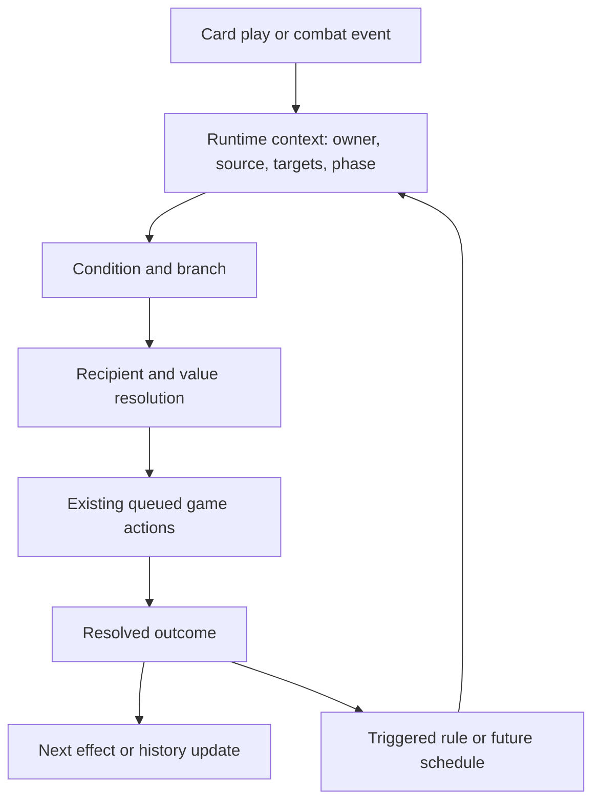

# Shared Effect Design for Whiskey

[Card map](../../Whiskey%20missing%20card%20effect%20logic.md) · [Implementation plan](WHISKEY_IMPLEMENTATION_PLAN.md)

## Goal and limits

Use reusable components with clear responsibilities. A card supplies configuration; a component implements a mechanic. Avoid `GotEmEffect`, `ReturnToSenderDamage`, card-title comparisons, and one new status enum per trigger/reward combination.

This is a proposed design derived from the supplied cards and inspected code. Names marked **proposed** are illustrative contracts, not existing APIs or a requirement to create that many files. Extend the repository's action/status architecture rather than replacing it. The [status workflow](../status-effects/ADDING_STATUS_EFFECTS.md) still governs future implementation and user-owned Editor/testing work.

## Existing code to preserve

| Existing code | Reuse | Gap relevant to this design |
|---|---|---|
| `Effect`, `AutoTargetEffect`, `PerformEffectGA`, `EffectSystem` | Authored effect → queued game action → performer. | Carry independent condition/recipient context and results when required. |
| `ConditionalEffect`, `EffectCondition`, `HasStatusEffectCondition` | Conditions evaluated at execution; target/caster stack checks. | Current conditional filters the same list passed to its payload. It cannot generally check an enemy and reward the owner or all enemies. No else branch. |
| `TargetMode`, `SelfTM`, `ManualTargetTM`, `AllEnemies`, `OneHeroTM` | Existing target resolution. | `OneHeroTM` automatically picks a different living hero. It is not a manual ally picker; `PlayCardGA`, `CardView`, and `ManualTargetSystem` accept enemies for manual selection. |
| `DrawCardsGA`, `CardSystem` | Owner-indexed draw piles, hands, and discards. | `DrawCardsEffect` does not resolve its owner and defaults to hero 0. |
| `AddStatusEffectGA`, `StatusEffectSystem`, `CombatantView` | Status ownership, stack changes, caps, removal, UI refresh. | Add bounded removal/transform operations without exposing the status dictionary. |
| `DamageSystem`, `DealDamageGA`, `FillStunGaugeGA` | Damage modifiers, Block, death, special attacks, percentage-gauge fill. | Publish results and distinguish flat Stun points from percentage fill. |
| `TriggerStatusEffect`, `TriggerStatusGA`, `DetonateStressGA` | Explicit Stress detonation, with trigger amount and consumption independent. | Return a detonation result for a following operation. |
| `CounterBuffs`, `AddCounterEffect`, `CounterAttackGA` | Counter grants with independent durations and existing attack behavior. | A grant currently carries damage/turns, not scoped additional strike effects. |
| `CombatantView.RecordAttack`, `OnAttackedCondition` | Existing enemy attack history. | Booleans and enemy-only recording cannot supply hero counters or aggregate attack counts. |
| `CardData.Type`, `Card.Type` | Existing Attack/Skill classification. | Add play history and an execution entry point usable outside a hand play. |
| `ActionSystem` | Ordered reactions and matched registration lifecycle. | Events must represent successful outcomes, not merely attempted action wrappers. |
| `Perk` / `PerkCondition` | Existing example of a subscription triggering an authored effect. | Assumes the first hero and persistent perk UI. Share suitable ownership-aware logic; do not reuse unchanged for temporary card rules. |

## Execution contract

Only the resolved event that a rule subscribes to should activate it. Add provenance and reentry controls so the feedback path cannot accidentally execute the same event/rule pair repeatedly.

### Authored data versus runtime data

**Authored data:** condition, subject scope, recipient mode, amount source, ordered payload, trigger filter, duration, and stacking policy. Keep fixed amounts as the normal authoring path. Optional calculated values must preserve saved cards when absent.

**Runtime context (proposed):** owner/caster, selected target, resolved targets, event source/target when applicable, source-card identity, phase/window identity, and named results from earlier operations. Add fields as a feature needs them; do not require every action to accept a large universal context immediately.

**Runtime state:** history, granted rules, scheduled jobs, per-play snapshots, and replay provenance. Never put these on shared `CardData`, `Effect`, or condition instances. Introduce context through a compatible overload/adapter or action payload rather than replacing every existing signature at once.

## G1 — Conditions, scopes, and branches

Separate three questions:

1. **What is inspected?** Selected enemy, owner, all enemies, actual hit results, or an event's source/target.
2. **How is it evaluated?** Single subject, any matching subject, or each qualifying target. Add other quantifiers only when needed.
3. **Who receives the payload?** Owner, selected target, all enemies, qualifying subjects, or the event's attacker.

Proposed additions are an `IsStunnedCondition`, a history-count comparison, and conditional composition with explicit subject and recipient selectors. Preserve current `ConditionalEffect` behavior as the default for existing assets.

Use two compositions:

- **Conditional payload:** if the condition passes, run an ordered payload once or once per qualifying subject, as configured.
- **Branch:** evaluate once, then select true or false payload. This implements Pummel Down, Throwing hand, and Roll With It without executing both outcomes.

An `Any` condition returns one boolean. It must not repeat an owner reward for each matching enemy. A missing live subject fails a live condition; an empty `Any` set is false.

**Timing is part of the contract.** Existing conditions read live state at execution. Preserve that default. For a reward depending on an earlier hit, use that action's named hit result or an explicitly captured pre-hit snapshot. Wrench Sweep must inspect enemies actually hit; do not substitute all currently living enemies and lose a qualifying enemy that died. Unresolved pre/post-hit choices remain in the plan.

Cheap Opening should evaluate once and run draw + Energy as one ordered payload. Two separate conditional nodes could disagree if reactions between them change state.

## G2 — Values and action results

Begin with a small typed value-source interface, not an expression-language interpreter:

| Proposed value source | Parameters | Consumers |
|---|---|---|
| Constant | Integer amount. | Existing fixed effects. |
| History count | Actor/recipient scope, event kind, window. | dramatic exit, Return to Sender; boolean conditions for Throwing hand/Brace for It!. |
| Status stack count | Subject and status. | Stress Test!. |
| Previous result | Named producer step, per-target result field. | Watch It Blow!; resonance only if its design uses resolved damage. |
| Scale and offset | Base + multiplier × input, optional bounded result. | Scaling attacks, doubled stacks, damage-to-Stun conversion. |

Use integer-safe arithmetic, validate nonnegative amounts where required, and specify rounding for ratios. Avoid unrelated random/expression features without a card requirement.

**Results belong to one execution and one target.** A proposed result can contain resolved target IDs, pre-hit condition snapshots, calculated damage, Block absorbed, actual HP lost, accepted status changes, and success/skipped state. Populate only fields needed by the implemented feature. Refer to a named producer step, never a global “last damage”: counter/Mark/Extra Attack reactions could overwrite it.

The producer must finish before its consumer reads the result. Do not evaluate all values when `CardSystem` initially queues a card. Preserve per-target results for area effects. If the producer skips, its dependent effect skips unless explicitly configured otherwise.

**Keep units distinct:** `FillStunPercent(15)` means 15% of maximum gauge; `AddStunPoints(value)` means a flat amount. Watch It Blow! cannot be implemented by sending 40 to the existing percent-fill action. Its damage basis, conversion, and rounding need a gameplay decision.

## G3 — Reusable state-changing operations

| Operation | Implementation direction | Rules |
|---|---|---|
| Deal damage | Reuse existing action/performer; accept fixed or resolved amounts. | Preserve attack-kind modifiers, Block, hit reactions, and death handling. |
| Apply status / gain Block | Reuse `AddStatusEffect` / `AddStatusEffectGA`. | Block is already a status; no second storage model. |
| Draw cards | Extend authored ownership resolution; reuse `DrawCardsGA(amount, heroIndex)`. | Owner must not depend on the visible hand. Preserve legacy saved-asset behavior where necessary. |
| Gain Energy | Add a grant operation in `EnergySystem`. | Do not misuse negative spending or turn refill. Validate owner/amount; decide overflow separately from refill. |
| Heal | Add shared health mutation and queued heal action. | Clamp to missing HP, update existing UI, skip dead/invalid targets unless revival is specified. Selection remains separate. |
| Remove status stacks | Remove through `RemoveStatusEffect`. | `removed = min(requested, current)` for a positive request. Bolt Stripper selects Block; removal is not damage or a hit. |
| Transform status amount | Calculate desired amount, enforce constraints, apply the difference through shared add/remove. | Stress Test! doubles 40 to 80 and 60 to 99. No raw dictionary writes or skipped UI/caps. |
| Fill Stun | Reuse percentage fill; add flat points only when needed. | Preserve cooldown/dead-target checks; label units explicitly. |
| Trigger status | Reuse configurable trigger/consumption. | Watch It Blow! uses All + None. Publishing a Stress result must not make it an ordinary attack. |

Use these operations directly, conditionally, reactively, or on a schedule. Keep separate performers where mechanics differ; a shared amount interface does not justify one large switch that mutates everything.

## G4 — Combat history

Record resolved facts once, then query them. Proposed records:

- **Resolved attack:** event ID, source, actual recipient after redirection, attack kind, parent/source-card identity, and phase/window IDs. A fully blocked landed hit still counts; skipped attacks and status ticks do not. A card's choice of counting once per action versus per hit remains a gameplay rule.
- **Accepted card play:** execution ID, owner, card definition/runtime reference as needed, `CardType`, order, and window. Record after validation accepts the play; an attempted `PlayCardGA` POST callback alone does not prove success.

`ReceivedAttackCount(owner, window)` supplies Throwing hand, Brace for It!, and Return to Sender. `PerformedAttackCount(heroScope, window, kindFilter)` supplies dramatic exit. `FirstPlayedCard(scope, Attack, window)` supplies following up. These are proposed queries over one history mechanism.

Do not count both a `CounterAttackGA`/`ExtraAttackGA` wrapper and its nested `DealDamageGA` as separate attacks for one strike. Follow-Up has another performer: publish the equivalent resolved fact with its correct kind.

A resolved hit remains historical evidence after its target dies. Expire window-specific records deliberately and clear combat history on restart/new setup. Define “this turn” across both heroes and the enemy phase before implementing those queries.

## G5 — Triggered and scheduled effects

### Trigger rules

A proposed runtime rule contains **owner + event kind + filter + payload + lifetime + stacking policy + optional trigger limit**. It owns its state. Event handling queues ordinary actions through `AddReaction`; it does not call `Perform` while busy.

| Card | Event/filter | Payload | Lifetime / limit |
|---|---|---|---|
| Got ‘em | Successful Vulnerable application; source = Owner; recipient = enemy. | Draw for Owner. | Rest of combat; current draft adds draw strength on reapplication. |
| I’ll get you back! | Resolved attack received by Owner. | Apply 1 Attack Up to Owner. | Duration unresolved. |
| Brace for It! | Qualifying attack in the observation window, including prior history if the final rule requires it. | Arm one draw job for next player-turn start. | One reward per activation. |
| Full Tune-Up | Owner's relevant counter grant responds to an attack. | Counter strike with additional 15% maximum-gauge fill. | Current-turn grant; extra fill belongs to that grant. |

Publish status application after mutation succeeds, with status, accepted amount, source, and recipient. Applying two Vulnerable stacks is one event, not two. Zero/negative/rejected/dead-target applications and decay produce no application event. Preserve Got ‘em's order: status application finishes before its queued draw.

Register one event handler per system and remove it on disable; keep rules in an owner/combat registry. Do not subscribe every frame or on shared effect definitions. Clear rules and jobs at combat reset. Event IDs/provenance and activation limits prevent accidental reentry without suppressing legitimate separate hits or grants.

### Scheduler

Maintain a separate queue for **one-shot jobs**: owner, due phase/window, payload, target binding policy, cancellation. It shares ownership/context conventions with trigger rules; a queued job is not an ongoing subscription.

- Brace for It!: consume its one draw job before executing the payload, preventing duplicate delivery through reentry.
- Gear overheat: retain the chosen card and execute at the agreed turn-end boundary through the shared resolver.
- Revalidate held targets when due; do not silently retarget without a card policy.
- Clear jobs on reset; specify death/removal cancellation and before/after-discard ordering.

Do not scatter new turn callbacks among `HeroSystem`, `TurnSystem`, and `StatusEffectSystem` and rely on enable order. Use explicit phase actions or one coordinator for the boundary. Existing code advances some counters/status buffs from multiple paths; audit those call sites before adding expiry so a grant expires once per intended phase.

### Counters retain retaliation ownership

`CounterBuffs` currently aggregates damage from active grants. Full Tune-Up's extra Stun must retain the identity/lifetime of its contributing grant. A proposed extension attaches strike payloads to grants and carries eligible ones into the counter action. Decide whether overlapping grants combine into one strike or separate strikes before changing existing behavior.

Do not add an independent attack-received rule that deals 10 damage while the existing counter system also retaliates. The counter path owns retaliation; generic events can observe it.

## G6 — Card execution and repetition

Extract a shared effect resolver from `CardSystem` later. Hand play keeps validation, payment, hand removal, and discard/Disintegrate movement. Replay/scheduled execution calls the resolver with explicit policies instead of duplicating those responsibilities.

Inputs: card reference/definition, owner, target or targeting policy, execution origin, payment/zone policy, and whether it contributes to card-play history. Revalidate targets and create fresh action/result objects each time. Resolution must not require the card to remain in hand or its hero's hand to be visible.

- **following up:** history selects the first eligible Attack card; execute using agreed policies. Define no-eligible-card behavior and prevent replay loops through provenance.
- **Gear overheat:** the scheduler supplies the selected card and due context; the same resolver handles its effects.
- **Repeated effects:** each hit finishes its reactions/death handling before the next. Read `RepeatCount`; do not multiply damage. Define retained versus rerolled targets where relevant. Inspect assets first to avoid turning two authored hits into four.

`ChancePercent` is adjacent existing data, but no scoped Whiskey card needs chance. Do not expand this work into a probability subsystem without a card requirement.

## Migration of the Got ‘em draft

The draft added `DrawOnVulnerable`, owner stack/reset handling, a dedicated `QueueDrawOnVulnerable` hook, and icon mappings. It awaits user testing and is not the generic rule mechanism described here.

1. Introduce the smallest successful-status-application event and owner-aware draw payload.
2. Represent Got ‘em as a rule: Vulnerable + source Owner + enemy recipient → Draw Owner; lifetime = combat.
3. If assets reference `DrawOnVulnerable`, keep its application as a compatibility adapter into that rule. Choose one authoritative strength value; UI and trigger registry must not diverge.
4. Remove/disable the dedicated draw hook when the adapter/rule activates. Never leave both mechanisms drawing for one application.
5. Keep serialized enum numbers stable. Do not remove/reorder `DrawOnVulnerable` or preceding entries; a new authoring format needs deliberate user-performed migration.
6. Preserve confirmed duration and ownership. Retain or explicitly revise per-application and additive-replay defaults after user review.

Generic rules can carry display metadata without an enum for every event/reward combination. Concrete statuses such as Vulnerable/Stress remain in the status system. A new UI registry is not required for the first trigger slice: preserve Got ‘em's icon/count through its adapter.
